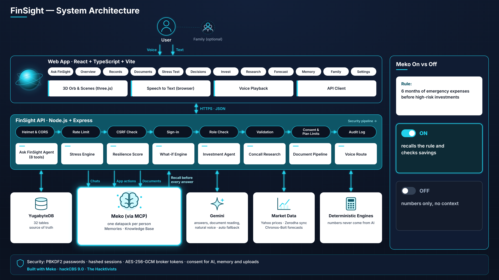

# FinSight

**Your personal AI financial advisor that remembers you.**

Ask in English, Hindi or Hinglish, by voice or text. FinSight checks your real numbers, tests them against bad days, and uses **Meko** to remember your rules, goals and past decisions, so its advice fits *your* life, not just your balance. Add your family when you want to plan together.

Built at **hackCBS 9.0** (Meko challenge, Track A) by **The Hacktivists**: Aviral Madhvan and Ishita Saxena.



---

## Contents

- [The problem](#the-problem)
- [Meko on vs off](#meko-on-vs-off)
- [Features](#features)
- [How FinSight uses Meko](#how-finsight-uses-meko)
- [Architecture](#architecture)
- [Tech stack](#tech-stack)
- [Quick start](#quick-start)
- [Demo accounts](#demo-accounts)
- [Configuration](#configuration)
- [Tests](#tests)
- [Security and privacy](#security-and-privacy)
- [Repository layout](#repository-layout)
- [Documentation](#documentation)

---

## The problem

Most people's money is spread across bank apps, demat accounts, FDs, gold, loans and paperwork. No single app shows the full picture, and none of them knows the **story behind the numbers**: your rules, goals and past decisions.

So advice is often right on paper but wrong for the person. "You have enough savings to buy this stock" ignores that you agreed to keep six months of expenses saved first.

## Meko on vs off

A switch on the chat turns Meko on or off. Same question, same numbers, different advice:

| | |
|---|---|
| **1. The family rule** | Maintain 6 months of emergency expenses before taking on new high-risk investments. (Agreed in a chat; Meko extracted it as a memory.) |
| **2. Meko on** | Recalls this agreed family rule, checks current emergency savings, and explains whether buying the stock aligns with it. The recalled rule is shown under the answer. |
| **3. Meko off** | Sees the portfolio numbers but lacks the context behind the family's decision. Nothing is recalled and the chat is not remembered. |

Balances, scores and stress tests stay exact either way: they come from YugabyteDB and our engines, not from memory.

---

## Features

### Ask FinSight (home page)
- **Chat-first home** with a live **3D orb** (three.js) that listens, thinks and speaks.
- **Voice**: browser speech recognition (English / Hinglish or Hindi), a **natural AI voice** (Gemini TTS, with fallback across 4 voice models and then the browser voice), hands-free mode, Stop and Cancel.
- **Grounded answers**: the agent uses **8 tools** (`get_financial_summary`, `run_stress_test`, `find_breaking_point`, `evaluate_decision`, `list_holdings`, `get_stock_quote`, `search_memory`, `search_documents`), and every number comes from their results.
- **Transparent**: each answer shows the steps it took and **what Meko recalled**, with a Forget button, plus follow-up suggestions.
- **Just me / Family planning**: personal mode uses your own money and memory; family mode uses the family's numbers and the memory of members who choose to share.
- **Side cards**: resilience score, net worth, months covered if income stops, alerts and shortcuts.

### Overview and Resilience Score
- **9 KPIs**: net worth, total assets, liabilities, liquid, semi-liquid and illiquid assets, monthly income, outflows, savings rate.
- **3D asset map**, sector exposure, largest investments, loss if markets fall, income versus outflows, alerts and insights.
- **Resilience Score (0–100)** from five explained pillars: Emergency Cash Coverage, Cash Flow & Burn, Debt & EMI Burden, Portfolio Diversification, Market Shock Absorption. Deterministic ([methodology](docs/RESILIENCE_SCORE.md)).

### Money, records and documents
- Accounts, FDs, gold, property, loans, income and expenses, with **co-owners** and **private / family** visibility, and no double counting.
- **Zerodha**: read-only Kite Connect sync, plus a clearly labelled **simulated connection** for demos.
- **Documents**: 10 types (ITR, PAN, Aadhaar, CAS, broker and bank statements, salary slip, insurance, loan, other). With explicit consent, the original file goes to the person's **Meko knowledge base**, so the chatbot can answer from it. AI suggests incomes and holdings, which are added only when the user approves them. FinSight keeps metadata only, never the file.

### Planning
- **Stress test**: a month-by-month, deterministic simulation with **10 shock types** (market, sector, stock, income, expense, EMI, one-time cost, recurring cost, inflation, forced selling) and 4 tripwires (cash, runway, score, net worth). Includes the **breaking-point finder** and an AI **recovery plan** when the result is risky ([engine](docs/STRESS_ENGINE.md)).
- **Decisions**: what-ifs for a purchase, a loan, a new monthly cost, or buying or selling a stock, with the score before and after. Families can propose, discuss and vote.

### Investing and research
- **Investment agent**: live quote, fundamentals and history. Checks funds, **months of emergency cover left (target 6)**, resilience, volatility, drawdown, leverage, expensive debt and position size, each rated OK, medium or high risk. Shows the score impact and a 30% crash test, compares alternatives (keep the money, invest half, index fund, prepay debt), and adds concall research and Meko memories.
- **Company research**: from just a ticker, FinSight finds the company website (Yahoo profile) → investor relations pages → the newest earnings-call transcript. Gemini extracts the summary, guidance and risks, and **every quote is checked word for word** against the transcript. You can also ask your own questions about the call.
- **Price forecast**: Chronos-Bolt ranges (10–90% bands, up to 64 trading days), backtested against a naive baseline ([report](docs/FORECASTING.md)).

### Memory and family
- **Memory page**: everything Meko remembers about you, with Forget. Nobody can type or edit a memory.
- **Family (optional)**: roles (owner, admin, member, viewer), invitations, proposals and votes, a 3D family network, and an opt-in memory-sharing switch per person.

---

## How FinSight uses Meko

FinSight **never writes memories itself**. Meko builds them from real conversations and app activity.

| # | Meko use | Meko tools | Why |
|---|---|---|---|
| 1 | **Memory from chats** | `conversation_add_message` | Advice should remember your rules and goals without forms |
| 2 | **Memory from app actions**: stress tests, what-ifs, votes, evaluations, broker syncs, concall searches, uploads | `conversation_add_message` (activity notes) | What you *do* shows what you worry about and plan |
| 3 | **Recall before reasoning** | `memory_search` | The same question needs a different answer for different people |
| 4 | **Visible, controllable context** | `memory_get_all`, `memory_delete_by_id` | No black box: see what was recalled and forget anything |
| 5 | **Documents in the knowledge base** | `knowledgebase_upload_document`, `knowledgebase_document_status`, `knowledgebase_search`, `knowledgebase_delete_document` | Answer from your ITR or CAS without retyping it |
| 6 | **One datapack per person** | `datapack_create` | Personal context stays separate, even inside a family |
| 7 | **Opt-in family sharing** | search across shared datapacks | Plan together while each person's memory stays private |
| 8 | **Meko on/off switch** | (no recall, no storage when off) | User control, and live proof of Meko's value |

If the Meko plan refuses a new datapack, the person gets their own conversation in a shared datapack, with every read filtered to it. Details: [docs/MEKO.md](docs/MEKO.md).

---

## Architecture

```
User (voice / text) ─▶ Web app: React + TypeScript + Vite, three.js orb, Web Speech
                          │  HTTPS · JSON (/api)
                          ▼
             FinSight API: Node.js + Express
             Helmet & CORS → rate limit → CSRF check → sign-in → role check
             → Zod validation → consent & plan limits → service → audit log
                          │
   ┌──────────────┬───────┴──────┬──────────────┬─────────────────┬──────────────────┐
   ▼              ▼              ▼              ▼                 ▼                  ▼
YugabyteDB     Engines        Meko (MCP)     Gemini           Market data        Forecast service
32 tables,     score, stress, datapack per   agent, docs,     Yahoo prices,      Python FastAPI,
source of      what-if, risk  person: memory voice (TTS),     Zerodha Kite       Chronos-Bolt
truth          (pure maths)   + knowledge    auto fallback    (read-only/sim)
```

**Key rule:** the AI never invents numbers. Figures come from the database and the deterministic engines; the AI explains them, and every answer shows its sources and data gaps.

**How one answer is built:** you ask → Meko recalls your memories and documents → tools read your records and run the engines → Gemini writes the answer from those facts → you see what was recalled, and Meko stores the chat. With Meko off, the recall and storage steps are skipped.

**Data model (YugabyteDB, 32 tables, 7 migrations):**

| Group | Tables |
|---|---|
| Identity & security | `users`, `sessions`, `oauth_states`, `consents`, `subscriptions`, `usage_counters`, `audit_log` |
| Family | `families`, `family_members`, `family_invitations` |
| Money records | `accounts`, `holdings`, `liabilities`, `cashflows`, `transactions`, `broker_connections`, plus `account_owners`, `liability_owners`, `cashflow_owners` |
| Planning | `simulations`, `score_snapshots`, `proposals`, `proposal_votes`, `proposal_comments`, `agent_evaluations` |
| Research | `concall_analyses`, `research_sources` |
| Meko & documents | `meko_bindings`, `meko_settings`, `memory_shares`, `context_memories`, `documents` |

**Reliability:**
- **Chat:** a time limit on every Gemini call, with automatic fallback across several models.
- **Voice:** fallback across 4 voice models, then the browser voice.
- **Database:** reconnects on connect failures; a dropped connection fails one request, not the server.

---

## Tech stack

| Layer | Technology |
|---|---|
| Web app | React 18, TypeScript, Vite, React Router, TanStack Query, Recharts, lucide-react |
| 3D | three.js, React Three Fiber (voice orb, asset map, family network) |
| Voice | Web Speech API (speech to text, fallback voice), Gemini TTS (natural voice) |
| API | Node.js 20+, Express, Zod, Helmet, express-rate-limit, multer, pdf-parse, node-postgres |
| Database | YugabyteDB Aeon (PostgreSQL-compatible); embedded-postgres for local development |
| Memory & knowledge | Meko via the official MCP SDK (`@modelcontextprotocol/sdk`) |
| AI | Google Gemini (3.6 Flash with fallbacks; TTS models), Amazon Chronos-Bolt (small) |
| Forecast service | Python, FastAPI, PyTorch, pandas, uvicorn, Docker |
| Market & broker | Yahoo Finance, Zerodha Kite Connect |
| Testing | Node test runner (backend), Playwright (desktop and mobile browsers) |

---

## Quick start

Requirements: **Node.js 20+**, and Chrome or Edge for voice.

```bash
# 1. Backend
cd backend
npm install
cp .env.example .env        # set APP_ENCRYPTION_KEY; add GEMINI_API_KEY and the MEKO_* settings
npm run dev:db              # local PostgreSQL; copy the printed DATABASE_URL into .env
                            # (or set DATABASE_URL to your YugabyteDB Aeon cluster instead)
npm run seed:demo -- --reset
npm run dev                 # API on http://localhost:3000

# 2. Web app (new terminal)
cd apps/web
npm install
npm run dev                 # http://localhost:5173
```

Use `npm start` instead of `npm run dev` for demos: it runs the API without the file watcher, which on Windows can restart the server mid-request.

Optional forecast service: see [apps/forecast-service](apps/forecast-service) and [docs/FORECASTING.md](docs/FORECASTING.md). Full instructions, Docker and production checklist: [docs/DEPLOYMENT.md](docs/DEPLOYMENT.md).

## Demo accounts

`npm run seed:demo -- --reset` creates one demo family (add `--with-mehta` for a second). All demo users share the password **`demo-pass-123`** and are clearly labelled as demo data.

| User | Email | Notes |
|---|---|---|
| Rajesh Sharma | `rajesh@demo.finsight.test` | Main demo user; shares memory with the family |
| Priya Sharma | `priya@demo.finsight.test` | Shares memory |
| Arjun Sharma | `arjun@demo.finsight.test` | Shares memory; the ₹9 lakh car decision |
| Kamla Sharma (Dadi) | `kamla@demo.finsight.test` | Does not share memory |

A made-up ITR for the document demo is in [docs/demo/demo-itr-rajesh-AY2026-27.txt](docs/demo/demo-itr-rajesh-AY2026-27.txt).

**Try:** "Can I buy a new stock right now? What are my rules?", with Meko on and then off.

## Configuration

All settings live in `backend/.env` (see [`backend/.env.example`](backend/.env.example)). Never commit real keys.

| Setting | Purpose |
|---|---|
| `DATABASE_URL`, `DB_SSL`, `DB_SSL_ROOT_CERT` | YugabyteDB Aeon or local PostgreSQL |
| `APP_ENCRYPTION_KEY` | Encrypts broker tokens (AES-256-GCM) |
| `GEMINI_API_KEY`, `GEMINI_MODEL`, `GEMINI_FALLBACK_MODELS` | Chat agent, document reading, explanations |
| `GEMINI_TTS_FALLBACK_MODELS`, `GEMINI_TTS_VOICE` | Natural voice |
| `MEKO_ENABLED`, `MEKO_MCP_URL`, `MEKO_API_KEY`, `MEKO_DATAPACK_ID` | Meko memory and knowledge base |
| `ZERODHA_API_KEY`, `ZERODHA_API_SECRET`, `ZERODHA_SIMULATION` | Broker sync (real or simulated) |
| `FORECAST_SERVICE_URL` | Chronos-Bolt forecast service |
| `WEB_APP_URL`, `CORS_ORIGINS`, `SESSION_TTL_DAYS`, `MAX_FILE_SIZE_MB` | App settings |

Free-plan monthly limits per user: 3 investment evaluations, 3 concall analyses, 10 forecasts, 30 assistant conversations. Stress tests and core tracking are unlimited.

## Tests

```bash
cd backend && npm test                 # 86 tests: embedded PostgreSQL + an in-process Meko test double (offline)
cd backend && npm run test:remote      # against YugabyteDB Aeon
cd apps/web && npx playwright test     # 13 real-browser tests, desktop and mobile
```

## Security and privacy

- **Passwords and sessions:** passwords are hashed with PBKDF2 (210,000 rounds). Session tokens are random, and only their SHA-256 hash is stored.
- **Broker tokens:** encrypted with AES-256-GCM.
- **Request protection:** Helmet headers, a CORS allow-list, rate limits (300 requests per minute; login 20 per 15 minutes), and a CSRF header on cookie-based writes.
- **Access:** a role check on every family request, and an append-only audit log of key actions.
- **Consent:** separate consent for AI analysis, Meko memory and document uploads.
- **Privacy:**
  - Records are marked private or family.
  - Memory is private by default; family sharing is opt-in.
  - Uploaded files are never kept by FinSight, only their metadata.

More detail: [docs/SECURITY.md](docs/SECURITY.md).

## Repository layout

```
backend/                 API (Express), engine/ (pure financial maths), services/ (agent, Meko, documents, research…),
                         routes/, db/migrations/, scripts/ (seed, dev DB), tests/
apps/web/                React web app: pages/, components/ (Orb, three/ scenes), lib/ (api, voice, webgl)
apps/forecast-service/   Python FastAPI service for Chronos-Bolt forecasts
docs/                    Methodology, API, deployment, security, Meko, demo files
branding/                Logos and the architecture diagram
los2/                    Original iOS app (not maintained by this work)
```

## Documentation

| Doc | What's in it |
|---|---|
| [MEKO](docs/MEKO.md) | Person memory, family sharing, documents, what is sent to Meko |
| [API](docs/API.md) | Endpoint reference |
| [RESILIENCE_SCORE](docs/RESILIENCE_SCORE.md) | Score methodology |
| [STRESS_ENGINE](docs/STRESS_ENGINE.md) | Stress-test methodology |
| [FORECASTING](docs/FORECASTING.md) | Forecast model and backtest |
| [DATA_SOURCES](docs/DATA_SOURCES.md) | Market data, fundamentals, Zerodha, transcripts: limits and costs |
| [DEPLOYMENT](docs/DEPLOYMENT.md) | Local dev, tests, YugabyteDB Aeon, Docker, production checklist |
| [SECURITY](docs/SECURITY.md) | Controls, known gaps, Indian regulatory considerations |
| [STATUS](docs/STATUS.md) | What's done, partial and blocked |

---

**FinSight provides decision support, not investment advice. It never places trades or moves money.**

Built with Meko · YugabyteDB · Gemini — hackCBS 9.0 · The Hacktivists (Aviral Madhvan & Ishita Saxena)
